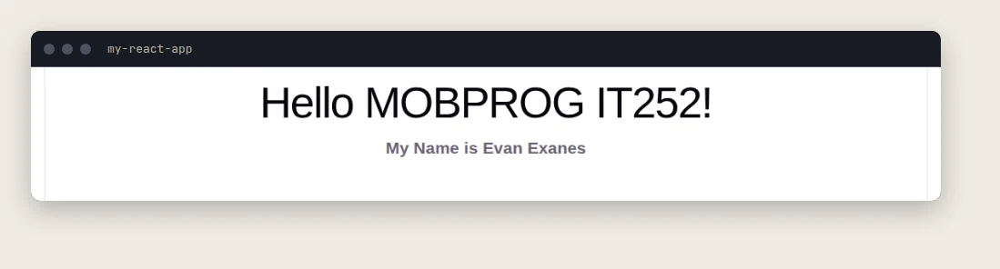

<div align="center">

# MOBPROG IT252: React exercises

**React exercises from the W3Schools tutorial, done for Mobile Programming (IT252) at Asia Pacific College.**


[](LICENSE)



<sub>The first exercise running in the browser.</sub>

</div>

## Contents
- [What this shows](#what-this-shows)
- [Exercises](#exercises)
- [Project layout](#project-layout)
- [Run it](#run-it)
- [Source file header](#source-file-header)
- [License](#license)
- [Author](#author)

## What this shows
- A React project created with Vite, following the first steps of the [W3Schools React tutorial](https://www.w3schools.com/react/), and run both on a laptop and in a GitHub Codespace.
- One React component: `App` is a function that returns JSX, and `main.jsx` mounts it into the `#root` element inside `StrictMode`.
- A clean public repository: no build output, no `.env` files, every hand-written source file carries a header and comments.

Only the first exercise is finished. The table below is the real state of the work and grows as I complete more of the tutorial.

## Exercises

| Folder | W3Schools section | Status |
|---|---|---|
| [`my-react-app/`](my-react-app) | Get Started: create a Vite and React app and render a first page | Done |

## Project layout

| Path | What it is |
|---|---|
| `my-react-app/` | The React app (created with `npm create vite`) |
| `my-react-app/index.html` | The single page; holds `<div id="root">` and loads `src/main.jsx` |
| `my-react-app/src/main.jsx` | Entry point: renders `<App />` into `#root` |
| `my-react-app/src/App.jsx` | The component that shows the greeting |
| `my-react-app/vite.config.js` | Vite settings: the React plugin, and `host: true` so a phone or a Codespace can open the dev server |
| `docs/screenshot.webp` | The picture above |
| `.gitignore` | Keeps `node_modules/`, `dist/`, `build/`, `.env` files and logs out of Git |

## Run it
You need [Node.js](https://nodejs.org/) 20.19 or newer (or 22.12+), because Vite 8 requires it. npm comes with Node.

```bash
git clone https://github.com/evanexanes/MOBPROG-IT252-react-w3schools.git
cd MOBPROG-IT252-react-w3schools/my-react-app
npm install
npm run dev
```

Open the Local address Vite prints, usually `http://localhost:5173`.

| Command | What it does |
|---|---|
| `npm run dev` | Starts the development server with hot reload |
| `npm run build` | Builds the app into `dist/` |
| `npm run preview` | Serves the built `dist/` folder |
| `npm run lint` | Checks the code with Oxlint |

**In GitHub Codespaces:** open a Codespace on this repository, run the same `cd my-react-app`, `npm install` and `npm run dev` in its terminal, then open the forwarded port from the **Ports** panel. The default Codespaces image already includes Node.js and npm.

## Source file header
The hand-written source files (`App.jsx`, `main.jsx`, `vite.config.js`, `index.html`) open with this block, and every later change adds a row to the history table:

```js
/*
Program name: App.jsx
Description: Root component of the W3Schools React exercises.
Author: Exanes, Evan Prens
Date Compiled: 11/05/2026
======================================================================
Date           Description                      Programmer name
======================================================================
11/05/2026     Initial Implementation           EPPE
======================================================================
*/
```

`EPPE` stands for Evan Prens P. Exanes. Files generated by Vite (styles, icons, lock file) are left as they are.

## License
Released under the [MIT License](LICENSE).

## Author
**Evan Prens P. Exanes** · [GitHub](https://github.com/evanexanes) · [Portfolio](https://evanexanes.github.io/) · [Contact](https://evanexanes.github.io/07-contact.html)
